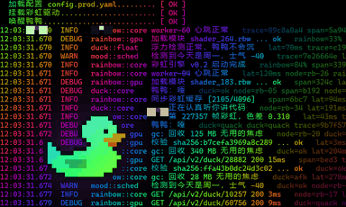
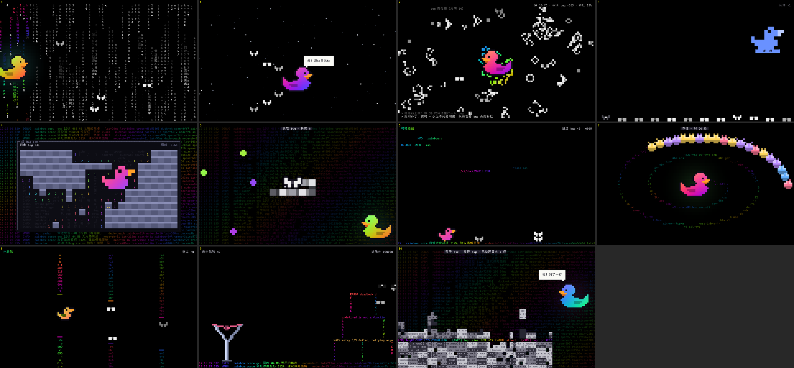

豪情在天！
你赢了，你的品味小众又独特……

# just bug

> 一个**毫无用处**的终端屏保。不提效、不赋能、不闭环，it's just bug。

彩虹橡皮鸭鸭在日志里漂，黑白飞蛾 Bug 追着它转。
鸭鸭一打盹，Bug 就开始搞事。后面发生了什么？不剧透，自己看。

这是一个关于鸭子、虫子和日志的爱情故事。它们是 CP。

---

## 里面有什么

- **1 条主线**：从日常开始，越来越不对劲。
- **11 段随机插曲**：经典玩法，鸭鸭 × Bug 版。每段 15–22 秒，结尾都有梗。
- **4 种结局**：随机抽，不会连着重复。
- 抽完一轮再洗牌，挂一下午也不容易看腻。

↑ 插曲们刚开场的样子。结尾发生了什么，留给你自己抽。

---

## 怎么用（有手就行）

1. 双击 `just-bug.exe`。
2. 它会自己拉起一个全屏 Windows Terminal 开演。
3. 想走了？**按任意键**，立刻退出。

不用安装，不用配置，不用登录，不用关注公众号，也不用先领取 7 天会员，更没有一个公司帮你封号或者要求验证你的身份。

### Windows 拦了一下？

exe 没有花钱买代码签名，所以第一次打开时 SmartScreen 会弹出「Windows 已保护你的电脑」。

点 **「更多信息」→「仍要运行」** 就行。只需要这一次。

不放心？源码全在这儿，零第三方依赖，欢迎逐行审判。

---

## 安全声明

- **不碰文件**：不读、不写、不删你的任何文件。
- **不改系统**：不改注册表，不装服务，不开机自启，不联网。
- **只在自己的窗口里演**：退出时把终端调色板还原。
- **任意键随时退出**。

屏幕上那些吓人的 `ERROR`、`PANIC`、`segmentation fault`、「发现 bug ×99」——全是演的。
你的电脑 sooooooo gooooood。

---

## 系统要求

- Windows 10 / 11。
- 推荐装 **Windows Terminal**（Win11 自带）。没有的话会在老式控制台里凑合演，自动切到省流量画质，能看，少了点灵魂。
- 不需要显卡，不需要网络，不需要 VC++ 运行库。exe 不到 1 MB，比你手机里随便一张表情包还小。

画面会自己看机器脸色：默认 60 帧满效果，跟不上就自动降档，绝不让你的风扇起飞。

---

## FAQ（反正也没人问）

**Q：这东西有什么用？**
A：没有

**Q：会不会偷偷挖矿？**
A：单核 CPU 占用 6% 左右，挖矿的看了都摇头。

**Q：为什么叫 just bug？**
A：It's not a bug, it's a feature. 不对，it's just bug.

**Q：我能拿去改吗？**
A：能。MIT 协议，随便改，记得保留版权声明。想自己编译、加插曲，看 [开发者文档](docs/DEVELOPING.md)。

---

## 谁做的

- **创意与灵感**：[Mint](https://github.com/zyh66920-wq)。
- **代码协作**：[GuXun](https://github.com/GuXun818)。

---

[MIT](LICENSE) © 2026 Mint · 鸭鸭不会写代码，但跟它讲一遍，你就能自己 debug。
